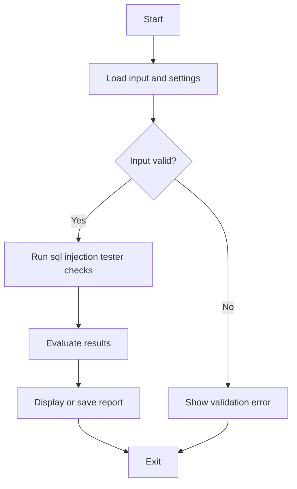

# 🧪 SQL Injection Tester


## Get this repository

Clone the current project (this repository's canonical GitHub URL), then follow the installation and usage steps below.

```bash
git clone https://github.com/cyberworlduniversity/sql_injection_tester.git
cd sql_injection_tester
```

> **Tool #17 in the Ethical Hacking Toolkit**  
> By **[hemanathan115](https://github.com/hemanathan115)**

---

## 📌 Description

**SQL Injection Tester** is a Python-based security testing tool that automatically:
- Discovers all HTML forms on a target web page
- Tests URL query parameters for injection points
- Sends **30+ common SQL injection payloads** to each field
- Detects vulnerable responses via SQL error signature matching
- Outputs a color-coded report and optional JSON results file

---

## ⚠️ Legal Disclaimer

> This tool is intended **strictly for educational purposes** and **authorized penetration testing only**.  
> Unauthorized use against systems you do not own or have explicit written permission to test is **illegal** and may violate the Computer Fraud and Abuse Act (CFAA) or equivalent laws in your country.  
> The author is **not responsible** for any misuse.

---

## 📁 Project Structure

```
sql_injection_tester/
├── sql_injection_tester.py   # Main tool script
├── requirements.txt          # Python dependencies
└── README.md                 # This file
```

---

## ⚙️ Installation

### 1. Clone the Repository

```bash
git clone https://github.com/cyberworlduniversity/sql_injection_tester.git
cd sql_injection_tester
```

### 2. Install Dependencies

```bash
pip install -r requirements.txt
```

---

## 🚀 Usage

### Basic Scan

```bash
python sql_injection_tester.py http://testphp.vulnweb.com/login.php
```

### With Custom Delay Between Requests

```bash
python sql_injection_tester.py http://testphp.vulnweb.com/login.php --delay 0.5
```

### Save Results to JSON File

```bash
python sql_injection_tester.py http://testphp.vulnweb.com/login.php --output results.json
```

### Full Options

```bash
python sql_injection_tester.py --help
```

| Argument   | Description                                      | Default |
|------------|--------------------------------------------------|---------|
| `url`      | Target URL to test                               | *(required)* |
| `--delay`  | Seconds to wait between each request             | `0.3`   |
| `--output` | JSON file to save vulnerability results          | *(none)* |

---

## 🔍 How It Works

1. **Fetches the target URL** and parses all `<form>` elements using BeautifulSoup
2. **Extracts input fields** (text, email, password, hidden)
3. **Injects 30+ payloads** covering:
   - Classic (`' OR '1'='1`)
   - Boolean-based blind
   - Time-based blind (`SLEEP`, `WAITFOR DELAY`)
   - UNION-based
   - Error-based
4. **Checks responses** for known SQL error signatures:
   - `you have an error in your sql`
   - `ORA-`, `SQLSTATE`, `pg_query`
   - `mysql_fetch`, `unclosed quotation mark`, etc.
5. **Reports vulnerabilities** with color-coded terminal output

---

## 🖥️ Sample Output

```
[*] Scanning: http://testphp.vulnweb.com/login.php
[*] Total payloads: 30

[*] Testing URL Query Parameters...
  [SAFE] No SQL injection found in URL parameters.

[*] Found 1 form(s) on the page.

[FORM 1] Action: /userinfo.php | Method: POST
  Fields: ['uname', 'pass']
  [VULNERABLE ⚠️ ] Payload: ' OR '1'='1 | Signature: 'you have an error in your sql' | Status: 200

======================================================================
[!] SCAN COMPLETE: 1 vulnerability/vulnerabilities found!
======================================================================
```

---

## 🧪 Safe Test Targets (Legal & Intentionally Vulnerable)

| Site | URL |
|------|-----|
| DVWA | `http://localhost/dvwa` (local setup) |
| testphp.vulnweb.com | `http://testphp.vulnweb.com/login.php` |
| WebGoat | `http://localhost:8080/WebGoat` (local setup) |
| HackTheBox / TryHackMe | Authorized lab environments |

---

## 📦 Dependencies

| Package | Purpose |
|---------|---------|
| `requests` | HTTP requests |
| `beautifulsoup4` | HTML parsing |
| `colorama` | Colored terminal output |
| `lxml` | Fast HTML parser (optional backend) |

---

## 👤 Author

**hemanathan115**  
🔗 GitHub: [https://github.com/hemanathan115](https://github.com/hemanathan115)

---

## 📄 License

This project is licensed under the **MIT License** — see [LICENSE](LICENSE) for details.

---

## 🌟 Part of the Ethical Hacking Toolkit Series

| # | Tool | Description |
|---|------|-------------|
| 17 | **SQL Injection Tester** 🧪 | Tests web forms for SQL injection vulnerabilities |
| ... | More tools | Coming soon... |

> ⭐ Star this repo if you find it useful!


## Repository Quick Start

Clone the canonical repository:

```bash
git clone https://github.com/cyberworlduniversity/sql_injection_tester.git
cd sql_injection_tester
```

### Requirements and installation

- Python 3.10+ is recommended.
Create an isolated environment and install dependencies:

```bash
python -m venv .venv
# Linux/macOS: source .venv/bin/activate
# Windows PowerShell: .venv\\Scripts\\Activate.ps1
python -m pip install -r requirements.txt
```

### Run

```bash
python sql_injection_tester.py
```

For scripts that expose command-line options, use `python sql_injection_tester.py --help` to inspect the options implemented in this version. Begin with sample or non-sensitive input.

### Validate source syntax

```bash
python -m compileall -q .
```

Only test applications and endpoints you own or are explicitly authorized to assess.

### Program flow


